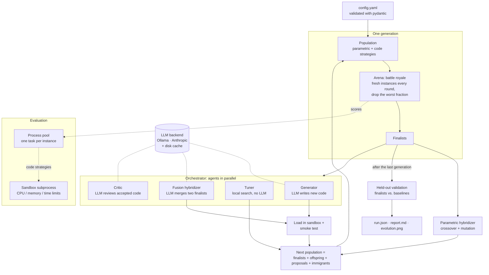
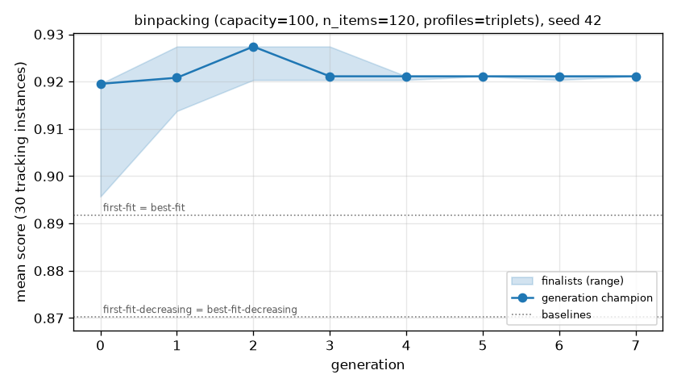
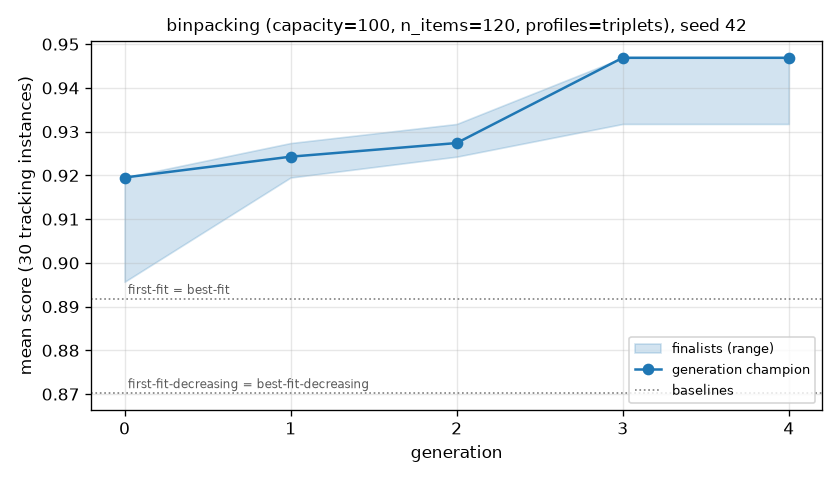
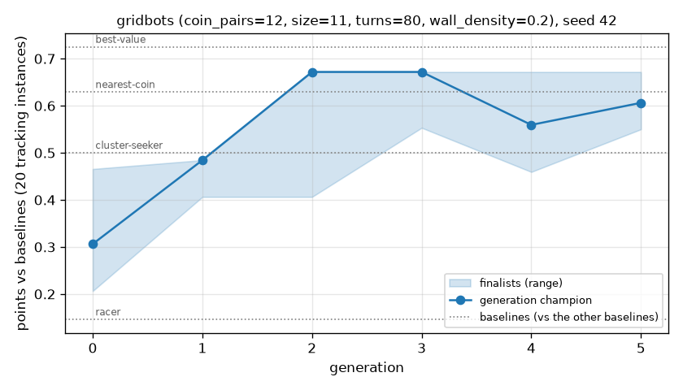
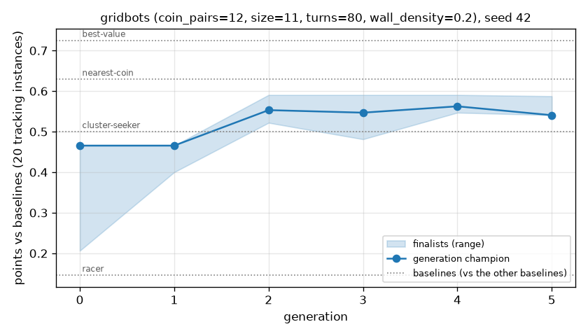

# stratarena

[](https://github.com/kaguya-dev/stratarena/actions/workflows/ci.yml)


**Choose strategies by simulation.** Given a problem and a way to score a strategy on one
instance, stratarena generates many candidate strategies, puts them through
battle-royale arenas on fresh random instances, eliminates the weakest, hybridizes the
best (including LLM-written code merged by an LLM) and repeats for several generations.
The winners are then scored on held-out instances that the search never saw, to catch
overfitting.

*Versão curta em português no [fim da página](#português).*

## The problem it solves

Many decisions are made by a heuristic: how to pack items, how to route, how a bot plays.
Picking one by hand, or by trying it on a few examples, tends to overfit those examples.
stratarena turns the choice into a reproducible experiment:

- every candidate plays **the same fresh instances** in each round, so comparisons are paired;
- rankings come with **95% bootstrap confidence intervals**, or with Elo-scale ratings in
  head-to-head games;
- the final answer is judged on a **separate held-out set**, next to known baselines;
- every run is **deterministic given its seed**: the same configuration writes a byte-identical
  `run.json`, and LLM answers are cached so even agent runs replay exactly.

## How it works



- **Problem** ([`problem.py`](src/stratarena/problem.py)): generates an instance from a seed
  and scores a strategy on it (`evaluate`), or plays two strategies against each other
  (`play`, for games).
- **Strategy** ([`strategy.py`](src/stratarena/strategy.py)): either a bounded parameter
  vector the problem interprets, or Python source with an entry-point function that runs in
  the [sandbox](src/stratarena/sandbox.py).
- **Arena** ([`arena.py`](src/stratarena/arena.py)): rounds on new instances, eliminate a
  configurable fraction, stop at the finalists. Games rank by points in a round robin
  (both sides of every map) and report Bradley-Terry ratings on the Elo scale.
- **Agents** ([`agents/`](src/stratarena/agents)): an orchestrator runs a code generator, an
  LLM fusion hybridizer, a critic and a parameter tuner in parallel. Code only competes after
  it loads in the sandbox and passes a smoke test.
- **Validation and reports** ([`validation.py`](src/stratarena/validation.py),
  [`report.py`](src/stratarena/report.py)): held-out scores, paired differences to the
  champion, a fixed tracking set to plot progress, Markdown and JSON per run.

## Install

Requires Python 3.12 and [uv](https://docs.astral.sh/uv/).

```bash
git clone https://github.com/kaguya-dev/stratarena.git
cd stratarena
uv sync                      # add --extra anthropic to use Claude
```

## Quick start

```bash
uv run stratarena run --problem binpacking --config configs/binpacking-triplets.yaml
uv run stratarena report runs/<run_dir>      # rebuild report.md and evolution.png
uv run stratarena summary runs/              # one table for many runs
```

Each run writes `config.yaml`, `run.json`, `report.md` and `evolution.png` to
`runs/<problem>-seed<seed>-<config hash>/` (plus `strategies/*.py` and the LLM transcripts
when agents are on).

Minimal Python example (about 2 seconds):

```python
import logging

from stratarena import RunConfig
from stratarena.examples import make_problem
from stratarena.log import configure_logging
from stratarena.search import run_search

configure_logging(logging.WARNING)
config = RunConfig(
    seed=0,
    problem="binpacking",
    problem_options={"n_items": 60, "profiles": ["triplets"]},
    population=12,
    generations=3,
    holdout_instances=30,
)
result = run_search(make_problem(config.problem, config.problem_options), config)

for entry in result.validation.entries:
    print(f"{entry.strategy_id:<22} {entry.kind:<9} {entry.holdout.mean:.3f}")
```

```text
g1-c03                 finalist  0.901
g2-c01                 finalist  0.900
g0-r03                 finalist  0.897
g2-c03                 finalist  0.897
best-fit               baseline  0.891
first-fit              baseline  0.891
best-fit-decreasing    baseline  0.870
first-fit-decreasing   baseline  0.870
```

## Results

All numbers below come from [`scripts/reproduce_results.sh`](scripts/reproduce_results.sh)
and `stratarena summary`; the full tables are in [`docs/results.md`](docs/results.md).
Every score is on **held-out instances** (100 for bin packing, 30 maps for Grid Bots), with
95% bootstrap intervals. Δ is the paired difference *best baseline minus champion*:
negative means the champion is better.

### Bin packing

An original parametric placement heuristic with 7 parameters. The classic heuristics
(first/best fit, with or without sorting) are exact points of this space and serve as
baselines. Score = optimum (or lower bound) / bins used.

| Instances | Seed | Champion | Best baseline | Δ [95% CI] |
|---|---|---|---|---|
| Triplets (known optimum) | 7 | 0.9411 | best-fit 0.8948 | −0.0463 [−0.0530, −0.0395] |
| Triplets | 42 | 0.9233 | best-fit 0.8940 | −0.0292 [−0.0354, −0.0236] |
| Triplets | 123 | 0.9479 | best-fit 0.8920 | −0.0559 [−0.0604, −0.0512] |
| Triplets, with agents (local LLM) | 42 | **0.9436** | best-fit 0.8940 | −0.0496 [−0.0539, −0.0445] |
| Mix of 4 profiles | 7 | 0.9118 | best-fit-decreasing 0.9118 | +0.0000 [+0.0000, +0.0000] |
| Mix of 4 profiles | 42 | 0.9255 | best-fit-decreasing 0.9257 | +0.0002 [−0.0005, +0.0010] |
| Mix of 4 profiles | 123 | 0.9190 | best-fit-decreasing 0.9202 | +0.0012 [+0.0003, +0.0023] |

- On **triplets**, where first/best fit decreasing are known to be suboptimal (0.87), the
  search finds heuristics that deliberately open new bins and beats every baseline by 3 to
  6 points in all three seeds.
- On the **mix of profiles**, it **does not** beat best-fit decreasing: it ties in two seeds and
  is slightly but significantly worse in one. The gains on triplets are cancelled out where
  the classic heuristics are already near-optimal.
- With **agents** (seed 42, `gemma4:e4b` via Ollama), the champion reached 0.9436 against
  0.9233 for the same seed without agents. The gain came from the **parameter tuner**, which
  uses no LLM: 7 of 8 code candidates from the LLM were admitted, two of them scoring above
  first-fit decreasing on the smoke test, and 1 of 4 fusions was admitted, but none reached
  the finalists.

| Triplets, seed 42 | Triplets with agents, seed 42 |
|---|---|
|  |  |

The charts show each generation's champion on a **fixed tracking set** that never influences
selection (arena instances change every round, so training means are not comparable across
generations).

### Grid Bots (head-to-head game)

An original two-player coin race on random point-symmetric maps. A bot weighs 5 features of
each move. Scores are points per game (win 1, draw 0.5) on 30 held-out maps against the
finalists and 4 simple baseline bots.

| Seed | Champion, plain arena | Δ vs best baseline | Champion, with sparring | Δ vs best baseline |
|---|---|---|---|---|
| 1 | 0.525 | +0.048 [−0.044, +0.137] | 0.575 | −0.007 [−0.156, +0.124] |
| 2 | 0.486 | +0.101 [+0.017, +0.185] | 0.671 | −0.086 [−0.179, +0.013] |
| 3 | 0.574 | −0.001 [−0.101, +0.098] | 0.610 | −0.036 [−0.125, +0.049] |
| 42 | 0.587 | +0.023 [−0.062, +0.096] | 0.541 | +0.108 [+0.026, +0.198] |
| **Mean** | **0.543** | | **0.599** | |

- In a plain arena, strategies are ranked only against each other. They learn (points against
  the baselines rise in early generations) but then drift toward beating their own population,
  and the champion never beats the best baseline significantly.
- **Sparring** (`sparring: true`) adds the baselines to every round robin as fixed opponents
  that are never ranked. It raises the champion's mean from 0.543 to 0.599 across 4 seeds and
  puts it ahead of the best baseline in 3 of them, though none of those wins is significant
  with 30 maps. Seed 42 goes the other way.

| Plain arena, seed 42 | With sparring, seed 42 |
|---|---|
|  |  |

## LLM agents

Enable them in the configuration (see
[`configs/binpacking-agents.yaml`](configs/binpacking-agents.yaml)):

```yaml
agents:
  enabled: true
  code_candidates: 2      # new code per generation (generator)
  fusion_candidates: 1    # code that merges two finalists (hybridizer)
  tuner_candidates: 2     # parameter local search, no LLM
  critic: true
  llm:
    provider: ollama      # or anthropic, or none
    model: gemma4:e4b
```

- **Ollama** (default): local; set `OLLAMA_HOST` for a remote server.
- **Anthropic**: `uv sync --extra anthropic` and credentials in the environment
  (`ANTHROPIC_API_KEY`); defaults to `claude-opus-5-5` with server-side refusal fallbacks.
  No key is ever stored in the repository.
- **none**: only the tuner runs, which is how the tests run.

Every LLM request and answer is cached under `.stratarena-cache/llm/`, keyed by a hash of
the request, and saved with the run in `agents/llm_exchanges.jsonl`. Rerunning the same
configuration replays the answers and reproduces the run exactly.

## Adding a problem

Implement the protocol in [`problem.py`](src/stratarena/problem.py) and register the class
in [`examples/__init__.py`](src/stratarena/examples/__init__.py):

```python
class MyProblem:
    name = "myproblem"

    def param_space(self) -> ParamSpace: ...  # bounded parameters
    def generate_instance(self, seed: int) -> MyInstance: ...  # deterministic
    def evaluate(self, strategy: Strategy, instance: MyInstance) -> EvalResult: ...

    # Optional: baselines() for reference strategies, code_spec() for LLM-written code,
    # or play(first, second, instance) instead of evaluate for a two-player game.
```

Problems must be picklable and deterministic; higher scores are always better.

## Limitations

- **The sandbox is not a security boundary.** Code runs in a separate process with CPU,
  memory, file-size and process limits and only the standard library, which contains
  accidents and keeps it away from the simulator. It can still use the network and read the
  user's files. It needs a POSIX system and has only been tested on Linux.
- **The small local model did not write better code.** With `gemma4:e4b`, LLM candidates
  mostly reimplemented best-fit decreasing; the critic sometimes gave wrong advice; fusions
  often failed the checks. A larger model may do better; this was not measured.
- **LLM sampling is not reproducible**; runs are reproducible only by replaying the cache.
- **Selection is noisy.** In bin packing triplets seed 42, the generation-2 champion scored
  0.927 on the tracking set and was then displaced by a candidate scoring 0.921. More instances per round reduce this at a proportional cost.
- **Bin packing scores on non-triplet profiles use a weak lower bound**, so a score below 1.0
  there does not mean a better packing exists.
- **Game results are noisy and depend on the opponents.** Training and held-out scores in
  games are against different fields, so their gap is not an overfitting measure. With
  sparring, the baselines are no longer unseen opponents in the held-out set (the maps are).
  Thirty maps give wide intervals.
- **Code strategies are slower**: each evaluation starts a sandbox process (about 16 ms), plus
  one IPC round trip per decision in games.
- Results above use one machine, a few seeds and two example problems.

## Built with AI

This project was built with AI assistance. **Built with Claude Code**: the code, tests,
configurations and documentation were written by Claude Code (Claude Opus 5.5) under the
author's direction, milestone by milestone, with the author approving the plan and each
milestone and choosing what to adjust. The experiments' agents ran on a local model,
`gemma4:e4b`, served by Ollama.

## Roadmap

- A stronger sandbox (Linux namespaces or seccomp, no network).
- A hall of fame of past champions as sparring partners, beyond the baselines.
- More example problems (scheduling, routing) and a CMA-ES tuner.
- Compare LLMs of different sizes on code generation and fusion, with cost and latency.
- Adaptive rounds that stop early when the confidence intervals separate.
- A release on PyPI.

## Development

```bash
uv sync --all-extras
uv run ruff check . && uv run ruff format --check .
uv run mypy src tests
uv run pytest --cov
scripts/reproduce_results.sh           # WITH_OLLAMA=1 also runs the agents experiment
```

CI runs lint, type checks and the tests on every push.

## Português

**stratarena** escolhe estratégias por simulação. Para um problema com função de avaliação,
gera muitas estratégias candidatas, coloca todas em arenas "battle royale" com instâncias
novas, elimina as piores, cruza as melhores (inclusive código escrito e fundido por LLM) e
repete por gerações. No fim, valida as vencedoras em instâncias separadas que a busca nunca
viu, para detectar overfitting. Tudo é determinístico dada a seed, e as respostas do LLM
ficam em cache para reproduzir a execução.

- **Bin packing (triplets):** a busca supera todas as heurísticas clássicas por 3 a 6 pontos
  em 3 seeds. Na mistura de perfis, empata com o best-fit decreasing e não o supera.
- **Agentes com LLM local (`gemma4:e4b`):** o ganho veio do otimizador de parâmetros, sem LLM;
  nenhum código do LLM chegou às finalistas.
- **Grid Bots:** com sparring, a média da campeã sobe de 0,543 para 0,599 em 4 seeds, sem
  vitória significativa sobre o melhor baseline.
- **Limitações:** o sandbox não é barreira de segurança; resultados de jogo são ruidosos;
  amostragem do LLM só é reproduzível pelo cache.

Desenvolvido com assistência de IA: **Built with Claude Code** (Claude Opus 5.5), sob a
direção do autor; os agentes dos experimentos usaram `gemma4:e4b` via Ollama.

## License

[MIT](LICENSE)
